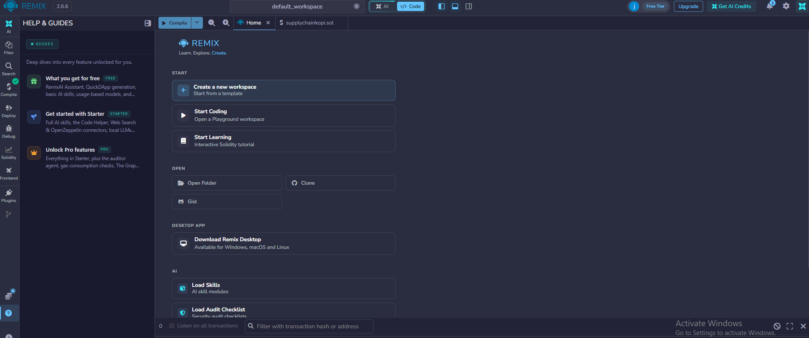
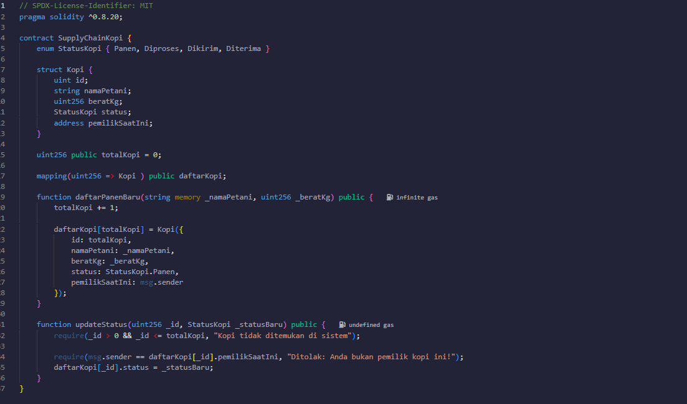
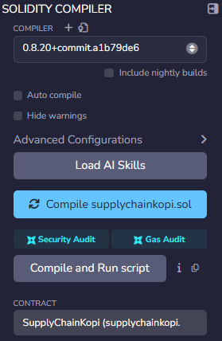
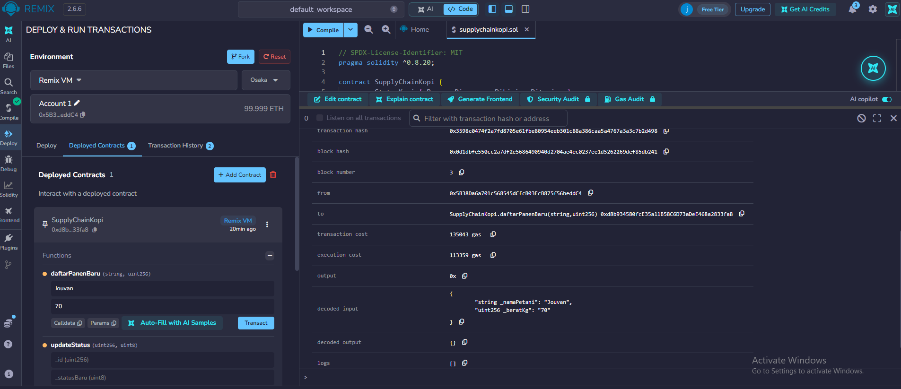
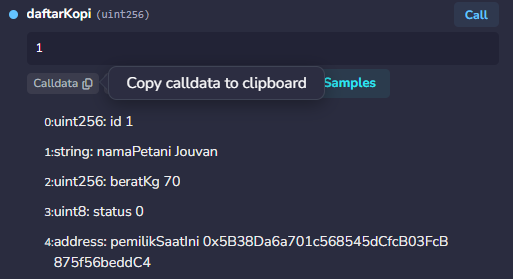

# praktikum 6: Menmbuat smart Contract dengan Solidity di Remix #

### tujuan Pebelajaran
Setelah menyelesaikan praktikum ini, mahasiswa diharapkan mampu:
1. Memahami konsep dasar dari smart contract dari blockchain
2. menggunakan platform remix untuk menulis, mengompilasi, dan men-deploy smart contract berbasis solidity.
3. mengimplementasikan fungsionalitas dasar smart contract yang memilihkan state variable dan fungsi.
4. melakukan interaksi dengant smart contract yang sudah ter-deploy melalui remix.

### Proses praktikum 
 
 1. buka {Remix IDE} (https://remix.ethereum.org/) login via gmai, bukti:
 

 2. buat file baru di files dengan nama file suplaychainkopi.sol
 isi koding sesuai dengan modul
 

 3. lakukan kompilasi dengan menekan tombol di samping kiri supplychainkopi.sol

 4. deploy smart constract ke blockchain
 A. deploy smart contract + menambahkan daftar panen

b. memanggil data panen

